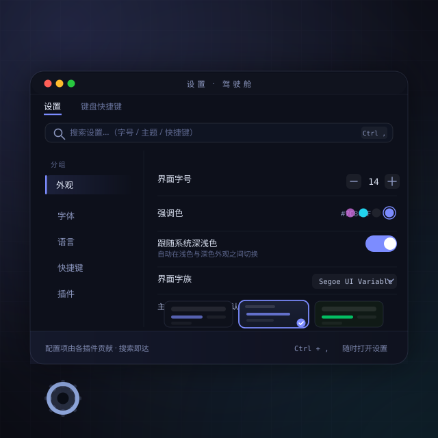

# Settings

Software settings — theme, language, and plugin management



## What it does

- Sidebar / panel surfaces: Settings.
- 10 commands, available from the Command Palette and the Plugin Store's Features tab.
- 1 settings, editable in Settings.

## Views

- **Settings**

## Commands

| Command | What it does |
|:--|:--|
| `settings.editKeybinding` — Change Keybinding… | Start editing a command's keybinding (same as double-clicking its row on the Keybindings page): if the page is open, enter edit mode immediately; otherwise ask the shell to open it first. Then use command to select the row—when omitted, show the command picker. Only that row enters edit mode; the user still presses the new keys (Enter commits, Esc cancels). |
| `settings.keybinding.copyId` — Copy Command ID | Copy the command id to the clipboard (used by the Keybindings page gear menu; e.g. workbench.action.selectLanguage). |
| `settings.keybinding.copyName` — Copy Command Name | Copy the command's display name to the clipboard (used by the Keybindings page gear menu). |
| `settings.keybinding.copyKey` — Copy Keybinding | Copy this row's keybinding string verbatim to the clipboard (including chord segments, e.g. ctrl+k ctrl+l). |
| `settings.keybinding.copyJson` — Copy as JSON | Copy this row's binding in the keybindings.json storage shape ({command, key, when?}—when is included only when present) so it can be pasted back into the file. |
| `settings.keybinding.resetToDefault` — Reset to Default | After confirmation, clear this row's user override, restore the built-in binding, and write keybindings.json. |
| `settings.keybinding.clear` — Clear Shortcut | After confirmation, clear **all** bindings for this row (including built-in/plugin defaults)—the command then has no key, and author-declared defaults do not come back automatically (use Reset to Default to restore them). Writes { command, key: "" } to keybindings.json. Requires LinkDesk 0.2.46+; hidden on older shells. |
| `settings.fileAssociations.clearRow` — Restore automatic (all types in this cell) | Remove this cell's keys (several file types sharing the same candidates and effective value) from the Default Open With override table in one go, restoring plugin declaration order. Called from the gear menu on the Needs Your Choice row. Requires LinkDesk 0.2.48+ (writes N types at once); older shells degrade to per-type writes with the same result. |
| `settings.fileAssociations.clearCard` — Clear Related Overrides | Restore automatic handling for every file type that was **actually set as default** under a plugin (keys owned by others are left alone—those are someone else's choice), and report how many were cleared. Called from the gear menu on a plugin card in Browse by Plugin. |
| `settings.fileAssociations.copyPluginId` — Copy Plugin ID | Copy a plugin's id to the clipboard (used by the gear menu on a plugin card in Browse by Plugin). |

## Settings

- **Open Style** (`settings.openForm`) — How Settings opens the first time — floatingPanel (floating panel) / tab (tab). Only the first open is affected; afterwards you can switch either way with "Open in Main Window" at the panel's top-right, or "Open in Floating Panel" in the tab's context menu.

## Install

Open the Plugin Store, find this plugin, and click Install. For offline use, install the `.linkdesk-plugin` package from disk.

## Development

```bash
npm install
npm run dev      # preview in the dev host
npm run lint     # eslint + manifest i18n completeness
npm run verify   # full repository gate
npm run build    # produce the .linkdesk-plugin package
npm run publish  # GitHub Release + catalog entry
```

See the repository root `README.md` for the Chinese documentation and the full directory contract.
